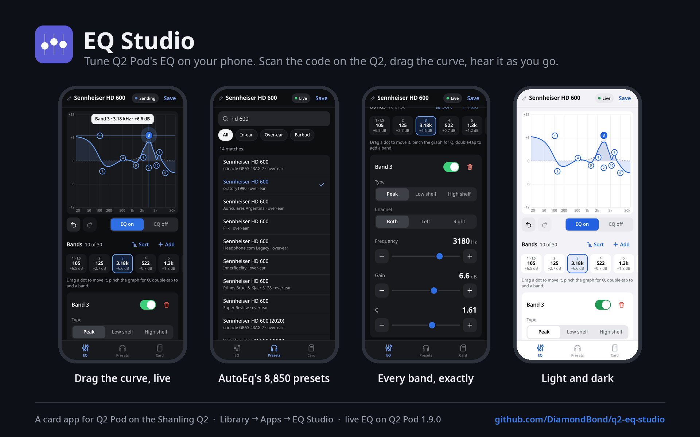

Edit the EQ of [Q2 Pod](https://github.com/DiamondBond/q2-pod) on your phone: the parametric EQ's bands as a curve you can drag, AutoEq's presets for thousands of headphones and IEMs, and what you set playing on the Q2 as you set it.

A card app for the Shanling Q2. Install it from Q2 Pod's App Store, or unzip `eq-studio.zip` at the card's root (it holds one folder, `.eq-studio`). It then appears in Library → **Apps**.

## Using it

Open **EQ Studio** on the Q2: it shows a QR code. Scan it with a phone on the same Wi-Fi as the Q2 and the editor opens, signed in. Or type the address under the code into the phone's browser and enter the PIN beside it. Return on the Q2 leaves the code; **Open on Your Phone** shows it again.

The Q2 stays awake while the phone is in use, and EQ Studio turns itself off after 15 minutes unused.

| Q2's row | Says |
| --- | --- |
| Open on Your Phone | The address and PIN; shows the QR code |
| Live EQ | What you set on the phone plays at once |
| No Live EQ | This Q2 Pod can't take the EQ from the phone |

### Live EQ

On a Q2 Pod with live EQ for card apps, the phone's EQ plays at once, as the Q2's EQ page's Apply does: into what EQ per Output keeps for the output playing, and an open EQ page shows it. The phone also turns the EQ on and off and starts from what the Q2 has set.

Without it, the phone is an editor: save a preset to the card's `EQ` folder, then on the Q2 open the EQ page's **Import from SD /EQ** and pick it.

### Bass and treble, and Poweramp's presets

**Bass** and **Treble** are Poweramp's knobs: Bass a low shelf at 90 Hz, Q 0.8, Treble a high shelf at 10 kHz, Q 0.6, their sliders 0 to +15 dB as Poweramp's turn. Each is a band of its own, named on its chip, so it goes to the Q2 and into a saved preset as any band does; its dot on the graph moves only up and down, as the knob turns, and at 0 its band goes. The Q2's filters are peaks and shelves, so a knob is the shelf Poweramp's settings describe, close to Poweramp's sound but not checked against it.

**Open file** on the Card tab also takes a preset exported from Poweramp (its `.json`): its bands and preamp, and Bass and Treble as those shelves, at the frequency and Q the file gives. What the Q2 can't take is said when the preset opens, and so is a preamp too small for the Q2, as Poweramp's often are: bands for one side only (the file doesn't say which side), more than 30 bands, values past the Q2's ranges. Poweramp's graphic-EQ presets aren't read: turn on its parametric EQ and export again.

## Files

On the card: `.eq-studio/config.json` holds the code's key and the PIN, made the first time and kept, so a phone signed in once stays signed in (delete the file for new ones). Presets saved from the phone go to `EQ/`, as `.txt` files in the Equalizer APO format the Q2 imports.

## Building

`./build.sh` builds `dist/eq-studio.zip` (and `dist/.eq-studio/`, what it holds): static Go for the Q2 (32-bit little-endian MIPS, soft float), the nan2008 ELF flag set and the binary checked by `tools/package.py`, the zip byte-identical from build to build. It needs Go 1.22 or later and Python 3, and nothing outside Go's standard library. `go test ./...` runs the checks.

On a computer, with folders standing in for the card and `/tmp`:

```
mkdir -p /tmp/eqs/mmc/.eq-studio /tmp/eqs/tmp
cp data/presets.json.gz /tmp/eqs/mmc/.eq-studio/
go run . -dir /tmp/eqs/mmc/.eq-studio -card /tmp/eqs/mmc -tmp /tmp/eqs/tmp
```

It prints the address with the key. Live EQ answers once a `q2-addon.caps` holding `eq` is in the `-tmp` folder and something answers its `q2-eq-studio.eq` requests as Q2 Pod does.

`data/presets.json.gz` is `gzip -9n` of Theme Studio's `docs/presets.json`. `python3 tools/icons.py` draws `card/icon.png` and `card/icon-40.png` (needs Pillow).

## Credits

- **Q2 Theme Studio** by Tyler ([tyleree](https://github.com/tyleree)), GPL-3.0: the phone page's EQ (`web/`) is its EQ tab, made for a phone.
- **File Browser** by group-a-study ([q2-filebrowser](https://github.com/group-a-study/q2-filebrowser)), MIT: the Q2 glue (`internal/`, `build.sh`, `tools/package.py`, `card/run`) and the sign-in. Its licence is `internal/LICENSE`.
- **AutoEq** by Jaakko Pasanen, MIT (`data/AUTOEQ-LICENSE.txt`): the presets, computed from measurements by Crinacle, oratory1990 and others.

## Licence

GPL-3.0-only (`LICENSE`). The files from File Browser keep its MIT licence.
