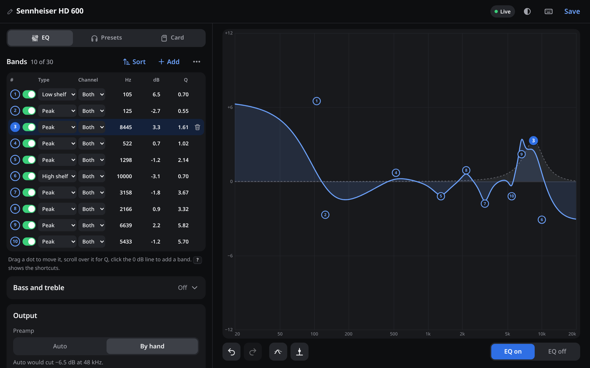

Edit the EQ of [Q2 Pod](https://github.com/DiamondBond/q2-pod) on your phone or computer: the parametric EQ's bands as a curve you can drag, AutoEq's presets for thousands of headphones and IEMs, and what you set playing on the Q2 as you set it.

A card app for the Shanling Q2. Install it from Q2 Pod's App Store, or unzip `eq-studio.zip` at the card's root (it holds one folder, `.eq-studio`). It then appears in Library → **Apps**.

## Using it

Open **EQ Studio** on the Q2: it shows a QR code. Scan it with a phone on the same Wi-Fi as the Q2 and the editor opens, signed in. Or type the address under the code into a browser, a phone's or a computer's, and enter the PIN beside it. Return on the Q2 leaves the code; **Open on Your Phone** shows it again.

The Q2 stays awake while the phone is in use, and EQ Studio turns itself off after 15 minutes unused.

| Q2's row | Says |
| --- | --- |
| Open on Your Phone | The address and PIN; shows the QR code |
| Live EQ | What you set on the phone plays at once |
| No Live EQ | This Q2 Pod can't take the EQ from the phone |

### On a computer



A window 960 pixels wide or more shows the computer's layout: the tabs in a sidebar and the graph beside them, so a preset picked under Presets shows on the graph as it plays. The bands are a table, each value typed in place (`1.2k` is 1200 Hz) or stepped with ↑ and ↓, Enter going down a row. Narrow the window and it's the phone's layout again, with the same preset, history and band picked.

On the graph, drag a dot to move a band (with Shift, finer), turn the wheel on a dot for its Q (with Shift, finer), turn it elsewhere to zoom the dB scale, click the 0 dB line to add a band there and drag it, or double-click to add one. A preset's file dropped on the page opens. The keys are PEQdB Studio's where it has them; **?** lists them.

| Keys | Do |
| --- | --- |
| 1, 2, 3, 4 | EQ, Presets, Response, Card |
| Space | Inspect the curve: a line at the mouse, and the gain there |
| Q, W, E | The band under the mouse (or the picked one): peak, low shelf, high shelf |
| S, D (or Delete, Backspace) | That band on or off; delete it |
| A (or +) | Add a band, at the mouse on the graph |
| [, ] | Pick the band before, after |
| ←, →, ↑, ↓ | With the graph focused or under the mouse, the band's frequency and gain (with Shift, finer) |
| `,`, `.` | The band's Q, wider or narrower |
| B | Every band off, or on |
| V | Each band's own curve |
| C | EQ on or off on the Q2 |
| F | Fit the curve to the graph, after the wheel zoomed it |
| / | Search the presets |
| Ctrl+Z, Ctrl+Shift+Z (or Ctrl+Y) | Undo, redo |
| Ctrl+C, Ctrl+V | Copy the EQ as text, open one pasted |
| Ctrl+S, Ctrl+O | Save to the card, open a file |
| Esc | Stop a drag where it began; Inspect off |
| ? | These keys, and the mouse's |

The theme button beside Save picks light, dark or the system's, on phones too.

### Response: a measurement under the EQ

The **Response** tab shows how an earphone or headphone measures, and what your EQ does to it. Pick who measured it (any reviewer on [squig.link](https://squig.link), Super* Review first: in-ears, headphones, earbuds, or earphones on a B&K 5128), search, and pick one. The graph draws its frequency response in grey, **Measured**, and the response with your EQ in bold, **Measured + EQ**, over the EQ's own curve. As on squig.link, it's 0 dB at 500 Hz and the scale opens to ±30 dB; the wheel zooms in. Edit the bands and the bold line follows. A phone goes to the EQ tab to show it; on a computer it's beside the list. Click its name under the graph to take it off.

Pick a **Target** too and it's drawn dashed, lined up at 500 Hz. These are the targets PEQdB Studio offers (less its own house curves), and squig.link's own:

| For | Targets |
| --- | --- |
| In-ears | Harman IE 2019, ∆ JM-1 −10dB Tilt, IEF Preference 2025, Knowles, Moondrop VDSF, ∆ Harman MoA 2025, Super 22, Crinacle 2023 Adjusted, Diffuse Field |
| Headphones | Harman OE 2018, Harman OE 2018 Linear Bass, Harman OE 2013, KEMAR KB50xx −10dB Tilt, KEMAR KB006x −10dB Tilt |
| A B&K 5128 | ∆ 5128DF −10dB Tilt, ∆ 5128DF |

Picking headphones brings a headphone target, and in-ears an in-ear one: each is made for the rig it's measured on. **AutoEQ**, beside the earphone's name under the graph, then fits the bands to bring it to the target, as AutoEq would: a low shelf at 105 Hz, a high shelf at 10 kHz and peaks between, nothing chased past 10 kHz, treble cuts to 6 dB and boosts to 6 dB, the preamp Auto. It replaces the EQ as a preset does; Undo takes it back.

The measurement and the target are only drawn: the Q2 plays the EQ, and neither is saved or sent to it. The phone or computer reads squig.link itself, so this needs its internet; the rest of EQ Studio needs none. It stays on the graph for the next visit in the same browser.

### Live EQ

On a Q2 Pod with live EQ for card apps, the phone's EQ plays at once, as the Q2's EQ page's Apply does: into what EQ per Output keeps for the output playing, and an open EQ page shows it. The phone also turns the EQ on and off and starts from what the Q2 has set.

Without it, the phone is an editor: save a preset to the card's `EQ` folder, then on the Q2 open the EQ page's **Import from SD /EQ** and pick it.

### Bass and treble, and Poweramp's presets

**Bass** and **Treble**, folded under their title until it's opened, are Poweramp's knobs: Bass a low shelf at 90 Hz, Q 0.8, Treble a high shelf at 10 kHz, Q 0.6, their sliders 0 to +15 dB as Poweramp's turn. Each is a band of its own, named on its chip, so it goes to the Q2 and into a saved preset as any band does; its dot on the graph moves only up and down, as the knob turns, and at 0 its band goes. The Q2's filters are peaks and shelves, so a knob is the shelf Poweramp's settings describe, close to Poweramp's sound but not checked against it.

**Open file** and **Paste** on the Card tab (and Ctrl+V) also take a preset exported from Poweramp (its `.json`): its bands and preamp, and Bass and Treble as those shelves, at the frequency and Q the file gives. What the Q2 can't take is said when the preset opens, and so is a preamp too small for the Q2, as Poweramp's often are: bands for one side only (the file doesn't say which side), more than 30 bands, values past the Q2's ranges. Poweramp's graphic-EQ presets aren't read: turn on its parametric EQ and export again.

### For other apps

The Card tab's **For other apps** saves the curve the Q2 plays for other EQs: Wavelet's GraphicEQ, miniDSP's biquads at 48 or 96 kHz, an impulse response (`.wav`, 24-bit) at 44.1 or 48 kHz for a convolver such as Equalizer APO's, Roon's or JamesDSP's, and a picture of the graph. Each is worked out from the Q2's own filters; what a format can't hold is said as it saves: Wavelet has one curve for both sides, and biquads carry no preamp or balance. The impulse response has both, and is stereo when the sides differ.

**Copy** puts the EQ on the clipboard as a preset's text, as Equalizer APO, AutoEq and PEQdB Studio read and write it, so an EQ goes back and forth with them.

## Files

On the card: `.eq-studio/config.json` holds the code's key and the PIN, made the first time and kept, so a phone signed in once stays signed in (delete the file for new ones). Presets saved from the phone go to `EQ/`, as `.txt` files in the Equalizer APO format the Q2 imports.

## Building

`./build.sh` builds `dist/eq-studio.zip` (and `dist/.eq-studio/`, what it holds): static Go for the Q2 (32-bit little-endian MIPS, soft float), the nan2008 ELF flag set and the binary checked by `tools/package.py`, the zip byte-identical from build to build. It needs Go 1.22 or later and Python 3, and nothing outside Go's standard library. `go test ./...` runs the checks.

On a computer, with folders standing in for the card and `/tmp`:

```
mkdir -p /tmp/eqs/mmc/.eq-studio /tmp/eqs/tmp
cp data/presets.json.gz /tmp/eqs/mmc/.eq-studio/
go run . -dir /tmp/eqs/mmc/.eq-studio -card /tmp/eqs/mmc -tmp /tmp/eqs/tmp
```

It prints the address with the key. Live EQ answers once a `q2-addon.caps` holding `eq` is in the `-tmp` folder and something answers its `q2-eq-studio.eq` requests as Q2 Pod does.

`data/presets.json.gz` is `gzip -9n` of Theme Studio's `docs/presets.json`. `python3 tools/icons.py` draws `card/icon.png` and `card/icon-40.png` (needs Pillow).

## Credits

- **Q2 Theme Studio** by Tyler ([tyleree](https://github.com/tyleree)), GPL-3.0: the page's EQ (`web/`) is its EQ tab, made for a phone.
- **PEQdB Studio** ([peqdb.com/studio](https://peqdb.com/studio)): the computer's layout, its keys and its mouse follow it. No code of it is here.
- **File Browser** by group-a-study ([q2-filebrowser](https://github.com/group-a-study/q2-filebrowser)), MIT: the Q2 glue (`internal/`, `build.sh`, `tools/package.py`, `card/run`) and the sign-in. Its licence is `internal/LICENSE`.
- **AutoEq** by Jaakko Pasanen, MIT (`data/AUTOEQ-LICENSE.txt`): the presets, computed from measurements by Crinacle, oratory1990 and others.
- **squig.link** and its reviewers: the measurements and targets under Response, each its reviewer's, read from squig.link as they're picked; only which ones are picked is kept, in the browser. The targets are Harman's, headphones.com's (JM-1), In-Ear Fidelity's, Knowles', Moondrop's and others', as their squig.link sites keep them.
- **AutoEq**'s approach shapes AutoEQ's fit (`web/fit.js`); its code is EQ Studio's own.

## Licence

GPL-3.0-only (`LICENSE`), with an added permission to offer it, or an app based on it, through app stores such as Apple's App Store and TestFlight ([APP-STORE-EXCEPTION.md](APP-STORE-EXCEPTION.md)). The files from File Browser keep its MIT licence.
